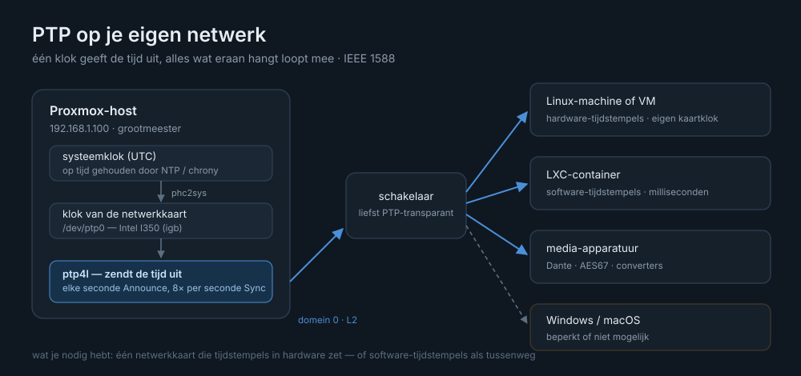

# PTP-grandmaster op je eigen netwerk

[](https://github.com/Theberas04/ptp-grandmaster/actions/workflows/ci.yml)

-2f9e44)


Eén commando op je Proxmox-host en je LAN heeft een **eigen tijdklok**: één machine geeft de tijd uit
(IEEE 1588 PTP, Precision Time Protocol) en alles wat eraan hangt loopt mee — Linux-machines, containers
en media-apparatuur. Geen account, geen abonnement, geen VPS; gewoon je eigen netwerk.

Dit is geen NTP met een nieuw jasje: PTP tijdstempelt op de netwerkkaart zelf. Daarmee haal je op een
LAN nanoseconden tot microseconden tussen de machines, waar NTP bij milliseconden blijft. Dat is precies
wat audio- en video-apparatuur (AES67, Dante, SMPTE) nodig heeft, en wat je wilt als je meet of opneemt.



## Waarom

- **Media**: Dante/AES67-apparatuur, mengpanelen en converters verwachten PTP op het netwerk. Zonder
  grootmeester zoeken ze er een en blijven ze stil.
- **Meten en opnemen**: twee machines die dezelfde klok delen, kun je tijdsynchroniseren zonder te
  rekenen met klokverschillen.
- **Containers en VM's**: alles in je Proxmox-omgeving loopt mee op één klok in plaats van ieder zijn
  eigen NTP-correctie.

## Wat je nodig hebt

- Een machine met **Debian 12/13** (je Proxmox-host kan het zelf zijn) als grootmeester.
- Een netwerkkaart met een **PTP-hardwareklok**: Intel **I350/I210** (`igb`), Intel **82580/82576**,
  Broadcom, Mellanox, of een nieuwere Intel. Onboard **Intel I219/I217** (`e1000e`) heeft er géén.
- Loopt je kaart niet mee: dan werkt het ook met **software-tijdstempels** (`SOFTWARE=1`), met
  milliseconden nauwkeurigheid in plaats van microseconden.
- Wil je de *absolute* tijd exact (microseconden van UTC), dan heb je een GNSS-ontvanger nodig; zonder
  die bron is je klok zo goed als je NTP-bron — maar alle machines lopen wél strak gelijk.

## Snel beginnen

Kijk eerst wat je machine kan (dit verandert niets en mag als gewone gebruiker):

```bash
bash <(curl -fsSL https://raw.githubusercontent.com/Theberas04/ptp-grandmaster/main/ptp-grandmaster.sh) --check
```

Zo ziet dat eruit op een host met een Intel I350 (uitvoer uit de testbank, zie `tests/`):

```
== Wat deze machine kan
  ok   root
  ok   linuxptp is nog niet geïnstalleerd
  netwerkpoorten:
    enp1s0f0     kaart: igb        PTP-klok: ptp0    hardware-tijdstempels: ja     in bridge: ja
    enp1s0f1     kaart: igb        PTP-klok: ptp0    hardware-tijdstempels: ja     in bridge: nee
    enp2s0       kaart: e1000e     PTP-klok: -       hardware-tijdstempels: nee (kaart heeft geen PTP-klok; alleen software-tijdstempels mogelijk)  in bridge: nee
  ok   gekozen poort: enp1s0f1
  ok   systeemklok is gesynchroniseerd (NTP)
  --check: er is niets veranderd.
```

Dan installeren, als root op de host:

```bash
bash <(curl -fsSL https://raw.githubusercontent.com/Theberas04/ptp-grandmaster/main/ptp-grandmaster.sh)
```

Wil je een specifieke poort, of software-tijdstempels:

```bash
# eigen poort kiezen (bijvoorbeeld de tweede poort van de I350, die nergens in hangt)
sudo PTP_DEV=enp1s0f1 bash <(curl -fsSL .../ptp-grandmaster.sh)

# geen PTP-klok op de kaart? dan software-tijdstempels
sudo SOFTWARE=1 bash <(curl -fsSL .../ptp-grandmaster.sh)

# eerst kijken wat er zou gebeuren, zonder iets te schrijven
sudo DROOG=1 bash <(curl -fsSL .../ptp-grandmaster.sh)
```

## Hoe het werkt

De keten is kort en je kunt elk schakeltje apart controleren:

1. **De systeemklok** van de host wordt op tijd gehouden door NTP (`chrony` of `systemd-timesyncd`).
   Dat blijft de baas over de *absolute* tijd.
2. **`phc2sys`** kopieert die systeemklok naar de **klok van de netwerkkaart** (`/dev/ptp0`).
3. **`ptp4l`** zendt de tijd uit als grootmeester: elke seconde een `Announce`, en met
   `logSyncInterval -3` acht `Sync`-berichten per seconde. De tijdstempels daarvan komen uit de kaart.
4. **De clients** draaien `ptp4l` als volgtende klok en `phc2sys` om hun systeemklok bij te stellen.
5. Alles op **domein 0**, transport **L2** (ruw Ethernet, de standaard in de mediawereld) of **UDPv4**.

De Grootmeesterverkiezing: met `priority1 64` (lager wint) neemt deze machine de rol over van andere
klokken op het netwerk, behalve van een klok met een lagere prioriteit. Komt er later een echte
grootmeester bij (bijvoorbeeld met GNSS), dan geeft dit script die voorrang als je `PRIORITY=200` meegeeft.

## Opties

| Variabele | Standaard | Wat het doet |
|---|---|---|
| `PTP_DEV` | automatisch | netwerkpoort die de tijd uitzendt |
| `DOMAIN` | `0` | PTP-domein, moet aan de client-kant gelijk zijn |
| `PRIORITY` | `64` | lager wint de verkiezing (PTP-standaard is 128) |
| `TRANSPORT` | `L2` | `L2` (media, ruw Ethernet) of `UDPv4` (makkelijker over routers) |
| `SYNC_INTERVAL` | `-3` | sync-berichten per 2^N seconde (`-3` = 8/s, media-standaard) |
| `CLOCK_CLASS` | `248` | kwaliteit die we claimen (`248` = niet traceerbaar, prima voor een NTP-bron) |
| `UTC_OFFSET` | `0` | `0` = onze klok loopt in UTC; `37` = strikte TAI-tijdschaal |
| `SOFTWARE` | `0` | `1` = software-tijdstempels in plaats van de kaartklok |
| `DROOG` | `0` | `1` = alles doen behalve schrijven en starten |

Op de opdrachtregel werken `--check`, `--dev <poort>`, `--dry-run`, `--uninstall` en `--software`.

## Clients laten meelopen

Op elke Debian-machine, VM of container die moet meelopen (ook als die zelf geen PTP-kaart heeft):

```bash
sudo bash <(curl -fsSL https://raw.githubusercontent.com/Theberas04/ptp-grandmaster/main/ptp-client.sh)
```

Dat script installeert `linuxptp`, zet `ptp4l` in clientmodus, laat `phc2sys` de systeemklok bijstellen,
en zet NTP uit (die twee vechten anders om dezelfde klok; met `OVERNAME=0` laat je NTP staan).

**Containers.** Een LXC kan meelopen, maar heeft geen eigen netwerkkaart met een PTP-klok: daar krijg je
automatisch software-tijdstempels (milliseconden). Voor hardware-tijdstempels in een container moet je
`/dev/ptp0` doorgeven en de container `cap_net_raw` en `cap_sys_time` geven — dat is een keuze in de
containerconfiguratie op de host, niet iets wat dit script voor je kan doen.

**Media-apparatuur** (Dante, AES67, converters): zet die op **domein 0** en **L2**. De klok die dit
script opzet is een gewone IEEE 1588-grootmeester; de meeste apparatuur accepteert die als
`clockClass 248`.

**Windows** is de lastigste: alleen Windows 11/Server 2019+ met een geschikte Intel-kaart kan PTP
gebruiken (via Windows Time). macOS kan het niet.

## Controleren of het werkt

```bash
ptp-status          # samenvatting: klokken, diensten, wat ptp4l vindt
ptp-status --log    # en de logregels erbij
```

Op een client zie je in het log de meetregels verschijnen:

```
ptp4l[22410239]: rms  204 max  527 freq  +7132 +/-   0 delay   973 +/-   0
ptp4l[22410241]: rms   84 max   93 freq  +7132 +/-   0 delay   973 +/-   0
```

`rms` is de afwijking in nanoseconden tussen de klok van de client en de grootmeester. Deze cijfers komen
uit de eigen proef (`tests/test-lock.sh`) op een virtuele kabel met software-tijdstempels: mediaan
**152 ns**, hoogste **494 ns**. Op een echte I350 met hardware-tijdstempels is het normaal onder de
100 ns.

## Beperkingen, eerlijk gezegd

- **De absolute tijd is zo goed als je NTP-bron** (milliseconden). PTP maakt de machines onderling
  gelijk tot nanoseconden; voor UTC-microseconden heb je GNSS nodig.
- **Eén machine is één klok.** Valt de host weg, dan loopt het netwerk door op de vrije loop. Voor
  mediaproductie wil je daarom een tweede grootmeester of een GNSS-klok als back-up.
- **Gewone switches** laten PTP wel door, maar voegen schommeling toe. PTP-schakelaars
  (transparante klok) geven de mooie cijfers.
- **Poorten in een bridge** (zoals `vmbr0`) werken als grootmeester, omdat de tijdstempels uit de kaart
  komen — maar een eigen poort die nergens in hangt is netter.
- De kaartklok kan maar op één poort tegelijk grootmeester zijn: bij een kaart met twee poorten kies je
  één poort als klokuitgang.

## Problemen oplossen

| Klacht | Oorzaak en oplossing |
|---|---|
| `hardware-tijdstempels: nee (kaart heeft geen PTP-klok)` | onboard Intel I219 of een Realtek-kaart. Gebruik `SOFTWARE=1`, of zet er een I350/I210 in. |
| Client vergrendelt niet, log toont `LISTENING` | Geen `Announce` van de grootmeester: verkeerd domein, verkeerd transport (L2 vs UDPv4), of een switch die multicast tegenhoudt. |
| Twee machines worden samen grootmeester | Er staat al een grootmeester met lagere prioriteit: zet `PRIORITY` lager dan die van de ander, of hoger als die moet winnen. |
| De klok springt op en neer | NTP en PTP vechten om de systeemklok: NTP uit (dat doet `ptp-client.sh`) of NTP laten lopen en PTP alleen voor media gebruiken. |
| `phc2sys` start niet | De dienst wacht op een vergrendelde `ptp4l` (`-w`). Draait `ptp4l` wel en ziet die de grootmeester? |
| `--check` vindt geen poort, maar de kaart zit er wel in | De kaart is nog niet geladen: `lspci -nnk \| grep -A3 -i ethernet`, `dmesg \| grep -i igb`. |

## Testen

Er is geen PTP-hardware nodig om te controleren of deze kit werkt:

```bash
bash tests/test-installer.sh    # 42 controles met een nep-PTP-kaart en nep-diensten
bash tests/test-lock.sh         # échte proef: grootmeester + client op een virtuele kabel
```

`test-lock.sh` haalt zo nodig het Debian-pakket `linuxptp` op, pakt het uit (zonder root), en laat twee
`ptp4l`-processen in een eigen netwerknaamruimte echt synchroniseren — met de configuraties die de
installateur schrijft. De proef meet en print de afwijking en zakt door de mand boven 100 µs. Dit draait
ook in CI (`.github/workflows/ci.yml`).

## Bestanden

- `ptp-grandmaster.sh` — grootmeester op de host (dit is de one-liner)
- `ptp-client.sh` — een machine, VM of container laten meelopen
- `ptp-status.sh` — status van de klok en de diensten
- `systemd/` — de eenheden die het script schrijft, ter lezing (met `__DEV__` als poort)
- `tests/` — testbank en de echte synchronisatieproef

## Licentie

Alle rechten voorbehouden. Gebruik op je eigen systemen mag; verspreiden of verkopen niet zonder
toestemming. `linuxptp` zelf is GPL-software uit de Debian-archieven en houdt zijn eigen licentie.
